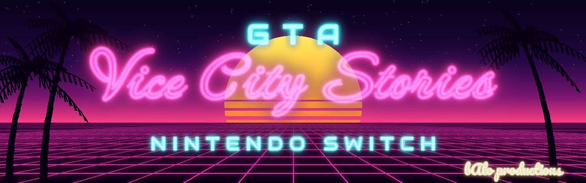

<p align="center">
  
</p>

<h1 align="center">VCSNX</h1>

<p align="center">
  <b>Grand Theft Auto: Vice City Stories</b> (PSP) running natively on the Nintendo Switch.<br>
  Not an emulator: the game's code is recompiled for the Switch, on your own PC, from your own copy.
</p>

<p align="center">
  <a href="https://github.com/fsalamancar/VCSNX/releases/download/v0.1.0/VCSNX-Builder-0.1.0.zip"><b>Builder (once)</b></a> ·
  <a href="https://github.com/fsalamancar/VCSNX/releases/latest/download/vcsnx.nro"><b>vcsnx.nro (latest)</b></a> ·
  <a href="#install-step-by-step">Install</a> ·
  <a href="#controls">Controls</a> ·
  <a href="#en-español">En español</a>
</p>

> [!IMPORTANT]
> **No game files are included, and none are downloaded for you.** You need your own copy of the PSP
> game: the US version, **ULUS-10160 v1.03**. This project is not affiliated with Rockstar Games,
> Take-Two Interactive, Sony or Nintendo. See [Legal](#legal).

## What you need

- A Nintendo Switch that runs homebrew (Atmosphère with hbmenu).
- A Windows 10 or 11 PC (64-bit), with internet the first time and about 5 GB free.
- **The PC port of GTA: Vice City Stories (VCSNative) set up with your own copy**:
  VCSNX uses its same `PSP_DATA` folder, with the decrypted executable
  `PSP_GAME\SYSDIR\EBOOT_DECRYPTED.ELF` and `PSP_GAME\USRDIR`. Prepare it as that port explains; if
  VCSNative already runs on your PC, the folder is ready.

## Install, step by step

1. **Download the two parts:**
   - **The Builder, once:** [`VCSNX-Builder-0.1.0.zip`](https://github.com/fsalamancar/VCSNX/releases/download/v0.1.0/VCSNX-Builder-0.1.0.zip). It does not change with updates.
   - **The runtime, always the newest:** [`vcsnx.nro`](https://github.com/fsalamancar/VCSNX/releases/latest/download/vcsnx.nro). This link always gives the latest one; it is the
     part that gets the fixes.
2. **Unzip the Builder** to a folder without accents, for example `C:\VCSNX-Builder` (right-click → *Extract
   All*). Then **copy the `vcsnx.nro` you downloaded into its `kit` folder**, replacing the one there: the
   Builder uses that file for your icon and your SD card.
3. **Open `VCSNX-Builder.exe`**: the *GTA VCS Compiler* window opens. If Windows says *"Windows protected
   your PC"*, click *More info* → *Run anyway*.
4. **1. Your game:** click **Choose** and pick your `PSP_DATA` folder. After a moment it shows
   **✓ GTA Vice City Stories ULUS-10160 1.03**. If it shows a message instead, the message says what to do.
5. **2. Icon (optional):** any PNG or JPG for the icon in hbmenu.
6. **3. SD card (optional):** put the Switch's SD card in the PC and pick it in the list.
7. **Click "Create vcs_game.so".** The first time it downloads the recompiled code and compiles it:
   about **20–60 minutes**, depending on the PC. You can cancel; next time it carries on where it stopped.
8. **Done.** If you picked the SD card, everything is already on it. If not, copy these to
   `sdmc:/switch/vcsnx/` on the SD card: `salida\vcsnx.nro`, `salida\vcs_game.so`, `kit\VCSNative.ini`
   and your `PSP_DATA` folder.
9. **Play.** On the Switch, hold **R** while you open any game from the HOME menu: hbmenu opens with
   the console's full memory. Open **VCSNX**.

The SD card ends up like this:

```
sdmc:/switch/vcsnx/
├── vcsnx.nro        the runtime (from the release)
├── vcs_game.so      the game's code (made on your PC)
├── VCSNative.ini    settings
└── PSP_DATA/        the game's files
```

**Updates:** only `vcsnx.nro` changes. Download it again from the same link ([`vcsnx.nro`](https://github.com/fsalamancar/VCSNX/releases/latest/download/vcsnx.nro)) and replace
`sdmc:/switch/vcsnx/vcsnx.nro` on the SD card; the Builder and your `vcs_game.so` stay as they are. Only if
VCSNX itself says that `vcs_game.so` must be made again does a release bring a new Builder, and its notes say so.

### If something goes wrong

| What you see | What to do |
|---|---|
| *"Windows protected your PC"* | *More info* → *Run anyway*. |
| *"Move the program's folder to a path without accents…"* | Move the folder, for example to `C:\VCSNX-Builder`. |
| Your antivirus blocks the compiler (`toolchain\devkitA64\...`) | Allow the program's folder and click *Create* again: what was compiled is kept. |
| *"This copy is not GTA Vice City Stories ULUS-10160"* | Only the US version 1.03 works. |
| *"The executable is encrypted"* | Prepare your `PSP_DATA` as the PC port (VCSNative) explains: the decrypted executable goes in `PSP_GAME\SYSDIR\EBOOT_DECRYPTED.ELF`. |
| VCSNX says there is not enough memory | Open it holding **R** over a game, not from the Album. |
| Anything else | The details are in `salida\builder.log`. Open an [issue](https://github.com/fsalamancar/VCSNX/issues) with it. |

## What you get

- The full game at 1280×720 (scaled to the TV when docked), with sound and the PSP's movies.
- Switch controls, and on-screen prompts that name the Switch's buttons.
- A smaller, sharper HUD (`[Display] HudScale` in `VCSNative.ini`).

## Controls

Each Switch button does what its PSP counterpart does in the original game:

| Switch | PSP | Notes |
|---|---|---|
| A / B / Y / X | ✕ / ○ / □ / △ | A confirms and B goes back in menus |
| Left stick | Analog stick | |
| Right stick | — | Free camera |
| D-pad | D-pad | |
| ZR / ZL | R / L on foot | Accelerate / brake in a vehicle |
| L / R | L / R | In a vehicle: look left / look right |
| R3, or L + R | L + R | In a vehicle: look behind |
| + / − | START / SELECT | |

Inverted aiming can be turned off in the game's *Pause → Controls* menu.

## How it works

The game's PSP code is statically recompiled to C++ by
[PSPRecomp](https://github.com/jessicanataliagta/PSPRecomp) with the
[vice-city-stories-recomp](https://github.com/OverkillLabs3/vice-city-stories-recomp) profile. That code
comes from the game, so it is never published here: the Builder downloads the recompiler's output, checks
it file by file, and compiles it on your PC into `vcs_game.so`. `vcsnx.nro`, the part published here, has
nothing of the game: it loads `vcs_game.so` when it starts, and draws with Vulkan (Mesa NVK), SDL2 and
FFmpeg.

## For developers: building everything by hand

<details>
<summary>Build the runtime and the game on macOS (Apple Silicon)</summary>

**Requirements:**
- [devkitPro](https://devkitpro.org/wiki/Getting_Started) with `switch-dev`, `switch-sdl2`,
  `switch-mesa`, `switch-ffmpeg`, `switch-libexpat` and `switch-libzstd`
- Homebrew: `cmake ninja pkg-config python3 git rsync`
- Docker Desktop (it builds the Switch's Vulkan driver once)

`tools/check_toolchain.sh` checks all of this and says what is missing.

1. **Vulkan driver for the Switch** (once, about 10 minutes in Docker):
   ```sh
   tools/build_mesa_switch.sh
   ```
2. **Your game files:** the same `PSP_DATA` folder the PC port uses, with `PSP_GAME/USRDIR/...` and the
   decrypted executable as `PSP_DATA/PSP_GAME/SYSDIR/EBOOT_DECRYPTED.ELF` (the UMD's own `EBOOT.BIN` is
   encrypted and its `BOOT.BIN` is blank).
3. **The recompiled code**, after a check that your executable is ULUS-10160:
   ```sh
   tools/restore_generated.sh PSP_DATA/PSP_GAME/SYSDIR/EBOOT_DECRYPTED.ELF
   ```
4. **Build:**
   ```sh
   cmake --preset switch
   cmake --build --preset switch      # → build/switch/vcsnx.nro and vcs_game.so
   ```
5. **Copy to the SD card** (mounted on your computer):
   ```sh
   tools/prepare_sd.sh PSP_DATA /Volumes/SWITCH
   ```

The Builder's design is in `docs/superpowers/specs/2026-10-11-vcsnx-builder-design.md` and its code in
`builder/` (.NET 10; `dotnet test builder/Builder.Core.Tests` runs on macOS).

**Extras made from your own files** (not included):
- Pro Controller pictures in the Controls menu: `python3 -I tools/make_switch_textures.py <folder>`, then
  copy the PNGs to `sdmc:/switch/vcsnx/Textures/` and set `[Textures] Replacement=true`.
- Sharper HUD fonts: dump the originals with `DumpOriginals=true`, then run `tools/make_hd_hud.py`.
- HOME menu icon: `tools/make_icon.py` cuts it from a cover image you provide (`local/icon.jpg`).

</details>

## Credits

- [PSPRecomp](https://github.com/jessicanataliagta/PSPRecomp) and
  [vice-city-stories-recomp](https://github.com/OverkillLabs3/vice-city-stories-recomp) (MIT): the
  recompiler and the game profile in `vendor/` (see `UPSTREAM.md`).
- The game-module loader is adapted from `so_util.c` by Andy Nguyen and fgsfds (MIT,
  `builder/licenses/so_util-LICENSE.txt`).
- [mesa-switch](https://github.com/danfromtico/mesa-switch) (the Vulkan driver), devkitPro, SDL2,
  FFmpeg (LGPL 2.1) and stb. Full list: `builder/licenses/THIRD_PARTY.md`.
- Banner fonts: Neonderthaw, Audiowide and Pacifico (SIL Open Font License 1.1).
- Switch port, splash, sound and banner: **bAlo productions**.

## Legal

- This project is not affiliated with, endorsed by or sponsored by Take-Two Interactive, Rockstar Games,
  Sony Interactive Entertainment or Nintendo.
- *Grand Theft Auto* and *Vice City Stories* are trademarks of Take-Two Interactive Software, Inc.;
  *PSP* is a trademark of Sony Interactive Entertainment; *Nintendo Switch* is a trademark of Nintendo.
  All other trademarks belong to their owners.
- No game assets, game code or game executables are in this repository or its releases. The game's code
  is made on your PC, from your copy, and stays with you.
- We do not condone piracy. Use a copy of the game that you own.
- The code of this project is MIT ([LICENSE](LICENSE)). `vendor/` keeps its own licenses. The bAlo logo
  and splash sound in `assets/splash/` and the banner in `assets/readme/` are not MIT: they ship with
  this project and its builds, but may not be used elsewhere.

---

## En español

<p align="center"><b>GTA: Vice City Stories</b> (PSP) nativo en Nintendo Switch. No es un emulador: el código
del juego se recompila para la Switch, en tu PC, con tu propia copia.</p>

> [!IMPORTANT]
> **No incluye archivos del juego ni los baja por ti.** Necesitas tu propia copia del juego de PSP: la
> versión de EE. UU., **ULUS-10160 v1.03**. Este proyecto no tiene relación con Rockstar Games,
> Take-Two Interactive, Sony ni Nintendo.

### Qué necesitas

- Una Nintendo Switch con homebrew (Atmosphère con hbmenu).
- Un PC con Windows 10 u 11 de 64 bits, con internet la primera vez y unos 5 GB libres.
- **El port de PC de GTA: Vice City Stories (VCSNative) armado con tu propia copia**:
  VCSNX usa su misma carpeta `PSP_DATA`, con el ejecutable desencriptado
  `PSP_GAME\SYSDIR\EBOOT_DECRYPTED.ELF` y `PSP_GAME\USRDIR`. Prepárala como explica ese port; si VCSNative
  ya funciona en tu PC, la carpeta está lista.

### Instalación paso a paso

1. **Baja las dos partes:**
   - **El Builder, una sola vez:** [`VCSNX-Builder-0.1.0.zip`](https://github.com/fsalamancar/VCSNX/releases/download/v0.1.0/VCSNX-Builder-0.1.0.zip). No cambia con las actualizaciones.
   - **El runtime, siempre el más nuevo:** [`vcsnx.nro`](https://github.com/fsalamancar/VCSNX/releases/latest/download/vcsnx.nro). Este enlace entrega siempre el último; es la parte
     que recibe los arreglos.
2. **Descomprime el Builder** en una carpeta sin acentos, por ejemplo `C:\VCSNX-Builder` (clic derecho →
   *Extraer todo*). Luego **copia el `vcsnx.nro` que bajaste dentro de su carpeta `kit`**, reemplazando el que
   está: el Builder usa ese archivo para tu ícono y tu SD.
3. **Abre `VCSNX-Builder.exe`**: se abre la ventana *GTA VCS Compiler*. Si Windows dice *"Windows protegió
   su PC"*, pulsa *Más información* → *Ejecutar de todas formas*.
4. **1. Tu juego:** pulsa **Elegir** y elige tu carpeta `PSP_DATA`. Al momento sale
   **✓ GTA Vice City Stories ULUS-10160 1.03**. Si sale un mensaje, el mensaje dice qué hacer.
5. **2. Ícono (opcional):** cualquier PNG o JPG para el ícono en hbmenu.
6. **3. SD de la Switch (opcional):** mete la SD de la Switch en el PC y elígela en la lista.
7. **Pulsa "Crear vcs_game.so".** La primera vez baja el código recompilado y lo compila: unos
   **20–60 minutos**, según el PC. Puedes cancelar; la próxima vez sigue donde quedó.
8. **Listo.** Si elegiste la SD, ya está todo en ella. Si no, copia a `sdmc:/switch/vcsnx/` en la SD:
   `salida\vcsnx.nro`, `salida\vcs_game.so`, `kit\VCSNative.ini` y tu carpeta `PSP_DATA`.
9. **A jugar.** En la Switch, mantén **R** mientras abres cualquier juego desde el menú HOME: se abre
   hbmenu con toda la memoria de la consola. Abre **VCSNX**.

**Actualizaciones:** solo cambia `vcsnx.nro`. Bájalo otra vez del mismo enlace ([`vcsnx.nro`](https://github.com/fsalamancar/VCSNX/releases/latest/download/vcsnx.nro)) y reemplaza
`sdmc:/switch/vcsnx/vcsnx.nro` en la SD; el Builder y tu `vcs_game.so` se quedan como están. Solo si VCSNX mismo dice
que hay que crear `vcs_game.so` de nuevo, un release trae un Builder nuevo, y sus notas lo dicen.

### Si algo falla

| Qué ves | Qué hacer |
|---|---|
| *"Windows protegió su PC"* | *Más información* → *Ejecutar de todas formas*. |
| *"Mueve la carpeta del programa a una ruta sin acentos…"* | Muévela, por ejemplo a `C:\VCSNX-Builder`. |
| El antivirus bloquea el compilador (`toolchain\devkitA64\...`) | Permite la carpeta del programa y pulsa *Crear* otra vez: lo ya compilado se guarda. |
| *"Esta copia no es GTA Vice City Stories ULUS-10160"* | Solo sirve la versión de EE. UU. 1.03. |
| *"El ejecutable está cifrado"* | Prepara tu `PSP_DATA` como explica el port de PC (VCSNative): el ejecutable desencriptado va en `PSP_GAME\SYSDIR\EBOOT_DECRYPTED.ELF`. |
| VCSNX dice que no hay memoria suficiente | Ábrelo manteniendo **R** sobre un juego, no desde el Álbum. |
| Otra cosa | El detalle está en `salida\builder.log`. Abre un [issue](https://github.com/fsalamancar/VCSNX/issues) con él. |

### Controles

A/B/Y/X hacen lo de ✕/○/□/△, ZR/ZL son R/L a pie y aceleran y frenan en un vehículo, el stick derecho
mueve la cámara, y en un vehículo L/R miran a los lados y R3 (o L + R) mira atrás. Los textos del juego
muestran los botones de la Switch.

### Legal

Este proyecto no tiene relación con Take-Two Interactive, Rockstar Games, Sony ni Nintendo, ni cuenta con su
aval. *Grand Theft Auto* y *Vice City Stories* son marcas de Take-Two Interactive; *PSP*, de Sony; *Nintendo
Switch*, de Nintendo. Ni este repositorio ni sus releases traen archivos, código o ejecutables del juego: el
código del juego se crea en tu PC con tu copia. No apoyamos la piratería: usa una copia que sea tuya. El
código es MIT; el logo y el sonido de bAlo en `assets/splash/` y el banner en `assets/readme/` no lo son.
